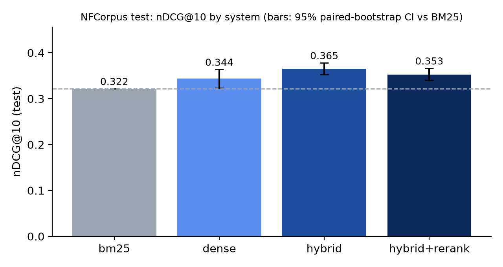

# clinical-evidence-retrieval

[](https://github.com/rkesseku/clinical-evidence-retrieval/actions/workflows/ci.yml)
[](https://colab.research.google.com/github/rkesseku/clinical-evidence-retrieval/blob/main/notebooks/finetune_embedder_colab.ipynb)

**Hybrid search and re-ranking for medical evidence retrieval, measured honestly.**
A retrieval stack of the kind that sits underneath every RAG system: BM25, a dense bi-encoder,
reciprocal rank fusion and a cross-encoder re-ranker, evaluated stage by stage on the BEIR
**NFCorpus** medical benchmark with per-query paired bootstrap tests and per-stage latency, plus a
FastAPI `/search` service and a Colab notebook that fine-tunes the encoder on the training queries.

## Why this exists

When a RAG answer is wrong, the cause is usually upstream: the right document was never retrieved.
Teams often bolt on "hybrid search" and "a re-ranker" because they are best practice, without
measuring whether each stage pays for its latency *on their own data*. This repo answers that question
for one medical corpus, with confidence intervals rather than single numbers:

* how much does a dense encoder add over a well-configured BM25 baseline?
* does fusing the two beat either alone?
* does an off-the-shelf cross-encoder (trained on web search, MS MARCO) help on medical text?
* what does each stage cost per query?

## Data

[NFCorpus](https://www.cl.uni-heidelberg.de/statnlpgroup/nfcorpus/) (Boteva et al., 2016) in its
[BEIR](https://github.com/beir-cellar/beir) release (Thakur et al., 2021): 3,633 PubMed documents
(title + abstract) and plain-language health questions from NutritionFacts.org, with graded relevance
labels (1 = indirectly relevant, 2 = directly cited). The **test** split has 323 queries with at least
one relevant document; the **train** split (2,590 queries, 110k judgements) and the **dev** split
(324 queries) are used only by encoder fine-tuning (training and checkpoint selection respectively). Download the zip from the official BEIR mirror and unzip it into `data/raw/`
(the data is not redistributed here; see the dataset's own terms):

```bash
curl -L -o data/raw/nfcorpus.zip https://public.ukp.informatik.tu-darmstadt.de/thakur/BEIR/datasets/nfcorpus.zip
unzip data/raw/nfcorpus.zip -d data/raw/
```

The queries are consumer health questions and the documents are research abstracts, so the
vocabulary gap between the two is large. That is what makes NFCorpus a useful, hard test of
"semantic" retrieval. It is not clinical-note data and contains no patient information.

## Method

| Stage | Implementation | Notes |
|---|---|---|
| Lexical | Okapi BM25 (Robertson & Zaragoza, 2009), own inverted index | Lucene-style IDF, `k1=0.9, b=0.4` (common defaults, *not* tuned on test), light stemming |
| Dense | `BAAI/bge-small-en-v1.5` via sentence-transformers | 33M parameters, cosine over normalised vectors, exact search, BGE query instruction |
| Fusion | Reciprocal rank fusion (Cormack et al., 2009), `k=60` | rank-only, so BM25 and cosine scores never need calibrating |
| Re-rank | `cross-encoder/ms-marco-MiniLM-L-6-v2` | re-scores the top 100 fused candidates |

Every system retrieves 100 candidates and is scored by one function (`evidence_ir.metrics`) using
trec_eval/BEIR conventions: nDCG@10 with graded gain, Recall@100, MRR@10. Differences are tested with a
**paired bootstrap over queries** (2,000 resamples, seed 0), reporting the mean difference, a 95%
percentile interval and a one-sided p-value. Latency is wall-clock per query, one query at a time,
on CPU.

## Results

All numbers below were produced by `evidence-ir run-all` on the NFCorpus test split (323 queries) and
are stored in [`docs/results/metrics.json`](docs/results/metrics.json), with per-query scores in
[`docs/results/per_query.csv`](docs/results/per_query.csv) and the full comparison table in
[`docs/results/report.md`](docs/results/report.md).

| System | nDCG@10 | Recall@100 | MRR@10 | Median ms / query (CPU) |
|---|---|---|---|---|
| BM25 | 0.322 | 0.242 | 0.527 | 0.4 |
| Dense (bge-small) | 0.344 | 0.313 | 0.531 | 336 |
| **Hybrid (BM25 + dense, RRF)** | **0.365** | **0.319** | **0.583** | 337 |
| Hybrid + cross-encoder re-rank | 0.353 | 0.319 | 0.579 | 14,852 |

Paired bootstrap differences in nDCG@10 (95% CI):

* **Hybrid vs BM25: +0.043 [+0.030, +0.056]**, a 13% relative gain; Recall@100 +0.076 [+0.060, +0.092].
* Dense vs BM25: +0.022 [+0.002, +0.042]. Hybrid vs dense: +0.021 [+0.008, +0.035].
  Fusion beats both of its inputs.
* **Re-rank vs hybrid: −0.012 [−0.026, +0.001].** The MS MARCO cross-encoder did *not* help here,
  while adding roughly 14.5 s per query on CPU. It was trained on web search clicks, and on consumer
  health questions against research abstracts it is out of its domain.



**Reading these numbers.** The BM25 figure (0.322) matches the BM25 baseline the BEIR paper reports for
this dataset (0.325), which is a check that the evaluation code is right. The latency figures come from
a laptop CPU that was running other jobs at the same time, so the absolute values are pessimistic; the
ordering (BM25 under 1 ms, encoder ~0.3 s, cross-encoder over 10 s for 100 pairs) is the useful part.
Encoding the 3,633 documents took 17 minutes on that CPU, a one-off cost.

**Encoder fine-tuning** is set up but has **not been run yet**: it needs a GPU, so no fine-tuning
results are reported here. The procedure lives in `evidence_ir/finetune.py` (tested on CPU with a fake
encoder) and the Colab notebook `notebooks/finetune_embedder_colab.ipynb` only calls it:

1. train `bge-small` with in-batch-negative contrastive loss (MNRL, no repeated query per batch) on the
   **train** qrels only;
2. after each epoch (up to 3, for each learning rate in 1e-5 / 2e-5 / 5e-5) score dense nDCG@10 on the
   **dev** split with the package's own metric code; the untuned model is a candidate too, so if
   fine-tuning never helps on dev, the base model is kept;
3. keep only the best dev checkpoint, then evaluate it and the base model **once** on **test**
   (BM25, dense and hybrid RRF) and compare them with the paired bootstrap.

The test split plays no part in training or selection. When it has been run, its outputs
(`finetune_metrics.json`, `finetune_report.md`, per-query scores) will go in `docs/results/finetune/`.

## What this shows

* Hybrid retrieval is the clear win on this corpus: cheap to add (fusion costs well under 1 ms), and
  significantly better than either lexical or dense retrieval alone on every metric.
* "Add a re-ranker" is not automatically right. A general-purpose cross-encoder cost two orders of magnitude
  more latency and made ranking slightly worse. Re-rankers should be validated on in-domain judgements,
  or a domain-adapted one used.
* Paired, per-query testing matters: the dense model's MRR gain over BM25 (+0.004) is noise, while its
  Recall@100 gain (+0.070) is not.

## Limitations

* One corpus, one test split, one run of each model (the neural stages are deterministic at inference,
  so the uncertainty shown is sampling over queries, not training variance).
* Hyper-parameters (BM25 `k1`/`b`, RRF `k`, candidate depth 100) are standard defaults; nothing was tuned
  on the test split, and tuning on the dev split might move all systems.
* Only small, CPU-friendly models were tested. Larger encoders and medical-domain re-rankers would
  likely change the re-ranking conclusion.
* Exact (brute-force) vector search is fine at 3.6k documents; a larger corpus would need an ANN index.

## How to run

```bash
pip install -e ".[dev,models,serve]"        # Python 3.10-3.12
pytest && ruff check src tests             # offline tests: tiny fake encoder, no downloads
evidence-ir run-all --bm25-only            # seconds; BM25 only
evidence-ir run-all                         # all four systems; downloads the two models (~200 MB)
python docs/brief/make_figures.py          # figures for the brief
evidence-ir serve --port 8000              # FastAPI: POST /search, GET /health
```

```bash
curl -s localhost:8000/search -H "content-type: application/json" \
  -d '{"query": "does cholesterol feed breast cancer cells?", "system": "hybrid", "k": 5}'
```

The response lists document ids, scores, snippets and per-stage timings in milliseconds.

## Project layout

```
src/evidence_ir/
  data.py      BEIR loader (plain jsonl/tsv files)
  text.py      tokeniser, stop words, light stemmer
  bm25.py      inverted-index BM25
  dense.py     sentence-transformers bi-encoder + exact search
  fusion.py    reciprocal rank fusion
  rerank.py    cross-encoder re-ranker
  pipeline.py  the four systems with shared stages and per-stage timing
  metrics.py   nDCG / Recall / MRR, paired bootstrap
  evaluate.py  run-all: metrics.json, per_query.csv, report.md, figures
  finetune.py  encoder fine-tuning: dev-selected checkpoint, single test evaluation
  serve.py     FastAPI app
  testing.py   offline fake encoder/scorer used by the tests
notebooks/finetune_embedder_colab.ipynb   Colab (GPU) runner for evidence_ir.finetune
docs/brief/brief.pdf                       project brief
```

## References

* Boteva, V., Gholipour, D., Sokolov, A., & Riezler, S. (2016). A Full-Text Learning to Rank Dataset
  for Medical Information Retrieval. *ECIR 2016*.
* Thakur, N., Reimers, N., Rücklé, A., Srivastava, A., & Gurevych, I. (2021). BEIR: A Heterogeneous
  Benchmark for Zero-shot Evaluation of Information Retrieval Models. *NeurIPS Datasets and Benchmarks*.
* Robertson, S., & Zaragoza, H. (2009). The Probabilistic Relevance Framework: BM25 and Beyond.
  *Foundations and Trends in Information Retrieval*, 3(4).
* Cormack, G. V., Clarke, C. L. A., & Buettcher, S. (2009). Reciprocal Rank Fusion Outperforms
  Condorcet and Individual Rank Learning Methods. *SIGIR 2009*.

## License

MIT, see [LICENSE](LICENSE).
