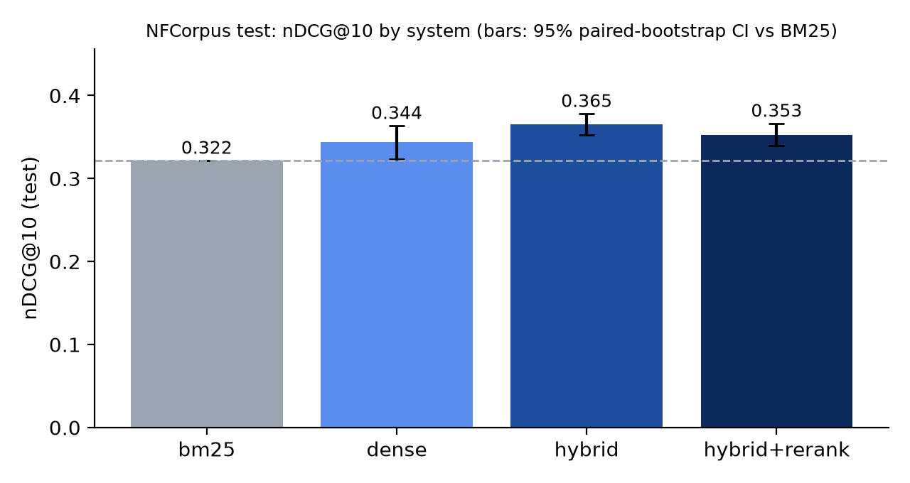
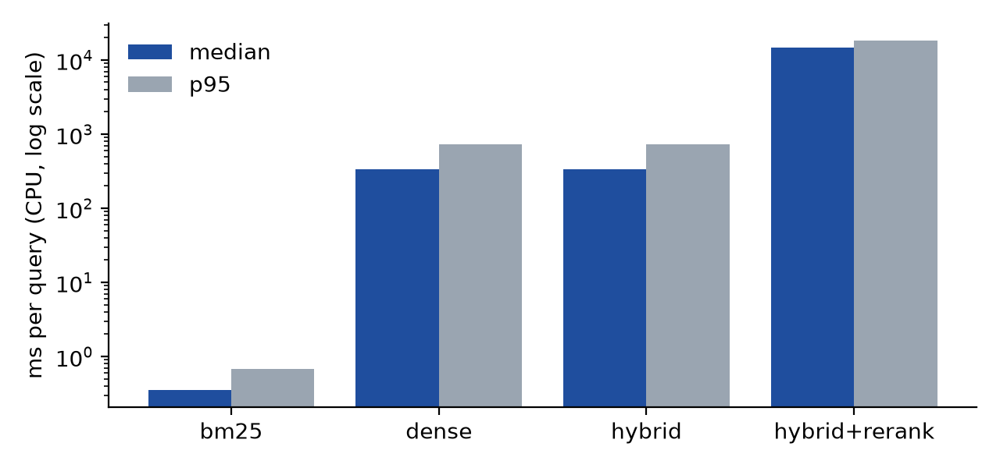

```{=typst}
#set text(hyphenate: false)
#show heading.where(level: 1): it => block(above: 1.2em, below: 0.6em)[
  #set text(fill: rgb("#1f4e9e"), size: 14pt, weight: "bold")
  #it
]
#show heading.where(level: 2): set text(fill: rgb("#2d2d2d"), size: 11.5pt)
#let glance(body) = block(fill: rgb("#eef3fb"), stroke: (left: 3pt + rgb("#1f4e9e")), inset: 10pt, radius: 2pt, width: 100%, body)
```

```{=typst}
#glance[
*At a glance* \
*Problem:* A retrieval-augmented (RAG) assistant can only be as good as the documents it retrieves. Teams add "hybrid search" and "a re-ranker" because they are considered best practice, usually without measuring whether each stage earns its latency on their own data. \
*What I built:* A retrieval stack (BM25, a dense bi-encoder, reciprocal rank fusion and a cross-encoder re-ranker) with one shared evaluation harness: graded nDCG\@10, Recall\@100 and MRR\@10, paired bootstrap tests over queries, per-stage latency, a FastAPI `/search` service, and a Colab notebook that fine-tunes the encoder. \
*Headline result:* On the 323 test queries of the BEIR NFCorpus medical benchmark, hybrid search raised nDCG\@10 from *0.322 (BM25) to 0.365*, a paired difference of +0.043 (95% CI [+0.030, +0.056]). An off-the-shelf web-search cross-encoder did *not* help (−0.012, CI [−0.026, +0.001]) and cost about 14.5 s per query on CPU. \
*Stack:* Python, NumPy, sentence-transformers (bge-small-en-v1.5, MiniLM cross-encoder), FastAPI, pydantic, matplotlib, pytest, GitHub Actions. \
*Repo:* #link("https://github.com/rkesseku/clinical-evidence-retrieval")[github.com/rkesseku/clinical-evidence-retrieval]
]
```

# The problem

Most "AI assistant" systems built on company or clinical knowledge follow the same pattern: a user asks a question, a *retriever* finds a handful of relevant documents, and a language model writes an answer from them. When the answer is wrong, the cause is very often the retriever. If the right document never makes it into the handful, no amount of prompt engineering can recover it.

Retrieval also has a cost profile that people underestimate. A keyword index answers in well under a millisecond. A neural encoder adds hundreds of milliseconds on a CPU. A cross-encoder, which reads the query and each candidate document together, is far more expensive again. Whether those costs are worth paying is an empirical question about a specific corpus and a specific user population, not a matter of best practice.

This project answers four concrete questions for one medical corpus, each with a confidence interval rather than a single number:

1. How much does a dense (embedding) retriever add over a well-configured keyword baseline?
2. Does fusing the two beat either one alone?
3. Does an off-the-shelf cross-encoder, trained on web search data, improve the ranking of medical evidence?
4. What does each stage cost per query?

## The data

NFCorpus (Boteva et al., 2016), in the version distributed with the BEIR benchmark (Thakur et al., 2021), pairs *plain-language health questions* written for the public (from NutritionFacts.org) with *PubMed research abstracts*, labelled 2 (directly cited as evidence) or 1 (indirectly relevant). The corpus has 3,633 abstracts. The test split has 323 questions with at least one relevant abstract; the separate training split (2,590 questions, 110k judgements) is used only for fine-tuning.

The questions and the documents are written in very different vocabularies ("does cholesterol feed breast cancer?" against a methods-heavy abstract), which is exactly where keyword search struggles and semantic retrieval is supposed to help. NFCorpus is a research benchmark, not clinical-note data, and contains no patient information.


# Approach

## Architecture

{#fig-arch width=100%}

## The stages

- *BM25* (Robertson & Zaragoza, 2009) is the standard keyword ranking function. It is implemented here from scratch over an inverted index, with Lucene-style IDF, light stemming and the common default parameters `k1 = 0.9`, `b = 0.4`. Nothing was tuned on the test questions.
- *Dense retrieval* encodes every abstract once with `BAAI/bge-small-en-v1.5` (33M parameters) and ranks documents by cosine similarity to the encoded question. At 3,633 documents, exact search over all vectors is simple and fast enough; a larger corpus would use an approximate index.
- *Reciprocal rank fusion* (Cormack et al., 2009) scores each document by the sum of `1 / (60 + rank)` across the two lists. It uses only ranks, so BM25 scores and cosine similarities never need to be put on a common scale. This is why RRF is robust and popular in production search.
- *Cross-encoder re-ranking* feeds each (question, abstract) pair to `cross-encoder/ms-marco-MiniLM-L-6-v2`, a model trained on Bing search data (MS MARCO), and re-orders the top 100 fused candidates by its score.

## Evaluation design

All four systems are scored by one function that follows the trec_eval / BEIR conventions:

- *nDCG\@10* rewards putting directly relevant (label 2) documents above indirectly relevant (label 1) ones in the first ten results;
- *Recall\@100* measures how much of the relevant evidence reaches the candidate pool at all;
- *MRR\@10* measures how high the first relevant result appears.

Because the same 323 questions are answered by every system, the comparisons are *paired*. For each pair of systems the harness resamples questions 2,000 times and reports the mean per-question difference, a 95% percentile interval and a one-sided p-value. Latency is wall-clock time per question, one question at a time, on a laptop CPU. The BM25 baseline reproduces the BEIR paper's published BM25 score for this dataset (0.322 here against 0.325 reported), which checks that the data loading and scoring are right.

The test suite (15 tests, run in CI on Python 3.10 to 3.12) uses a small hashing encoder and a word-overlap scorer in place of the neural models. It covers the metric definitions against hand-computed values, fusion arithmetic, BM25 behaviour, re-ranking order, the data loader's filtering, the bootstrap and the API, all without network access.


# Results

| System | nDCG\@10 | Recall\@100 | MRR\@10 | Median ms / query |
|---|---|---|---|---|
| BM25 | 0.322 | 0.242 | 0.527 | 0.4 |
| Dense (bge-small) | 0.344 | 0.313 | 0.531 | 336 |
| **Hybrid (RRF)** | **0.365** | **0.319** | **0.583** | 337 |
| Hybrid + cross-encoder | 0.353 | 0.319 | 0.579 | 14,852 |

: NFCorpus test split, 323 questions. All numbers come from `docs/results/metrics.json`, produced by `evidence-ir run-all`. {#tbl-results}

{#fig-ndcg width=78%}

| Comparison | Metric | Difference | 95% CI |
|---|---|---|---|
| Hybrid vs BM25 | nDCG\@10 | +0.043 | [+0.030, +0.056] |
| Hybrid vs BM25 | Recall\@100 | +0.076 | [+0.060, +0.092] |
| Dense vs BM25 | nDCG\@10 | +0.022 | [+0.002, +0.042] |
| Dense vs BM25 | MRR\@10 | +0.004 | [−0.036, +0.041] |
| Hybrid vs dense | nDCG\@10 | +0.021 | [+0.008, +0.035] |
| Re-rank vs hybrid | nDCG\@10 | −0.012 | [−0.026, +0.001] |

: Selected paired-bootstrap comparisons; the full table is in `docs/results/report.md`. {#tbl-boot}


## What the numbers say

*Fusion is the clear win.* Hybrid search beats BM25 on every metric, with intervals well clear of zero: +13% relative nDCG\@10 and nearly a third more of the relevant evidence in the top 100. It also beats the dense retriever alone (+0.021 nDCG\@10, +0.052 MRR\@10). Keyword and semantic matching fail on different questions, so combining them by rank recovers the strengths of both, for a fusion cost well under a millisecond.

*The dense model's gain is mostly about recall.* On its own, the embedding model lifts Recall\@100 by 0.070 but its MRR gain over BM25 (+0.004) is indistinguishable from zero. It finds more of the relevant evidence somewhere in the list without reliably putting it first. A per-question paired test is what separates these two effects; a single average would blur them.

*The re-ranker did not pay for itself.* The MS MARCO cross-encoder made nDCG\@10 slightly worse than plain fusion (−0.012, interval just touching zero) while adding about 14.5 seconds per question on CPU. Recall\@100 is unchanged by construction, because re-ranking only re-orders the pool. The likely cause is domain shift: the model learned relevance from short web passages and search clicks, not from consumer health questions matched to research abstracts. The practical lesson is that a re-ranker must be validated on in-domain judgements, or a domain-adapted one chosen, before it is added to a production path.

{#fig-lat width=72%}

## Cost profile

Per question, BM25 took 0.4 ms, the dense encoder about a third of a second and the cross-encoder over 14 seconds for 100 pairs (medians on a shared laptop CPU). Encoding the corpus once took 17 minutes on the same CPU; on a GPU both neural stages are much faster, but the ratios between stages remain. For this corpus the best quality-per-millisecond is hybrid fusion: it is the most accurate system and costs essentially the same as the dense retriever alone.

## Fine-tuning (set up, not yet run)

The notebook `notebooks/finetune_embedder_colab.ipynb` fine-tunes the encoder on the 2,590 training questions with a contrastive loss that uses the other documents in each batch as negatives (with no repeated question inside a batch). It then re-runs all systems on the same test split with the same code and paired tests. The hyper-parameters are fixed in advance and the test split is used once. It requires a GPU and has not been run yet, so no fine-tuning results are claimed here.


# What this demonstrates

- *Retrieval engineering for RAG*: lexical, dense, fusion and re-ranking stages built as interchangeable components behind one interface, with a service endpoint that reports per-stage latency.
- *Evaluation discipline*: standard IR metrics implemented and checked against hand-computed values, a baseline that reproduces the published figure, paired significance tests, and a willingness to report that a fashionable component made things worse.
- *Cost-aware decisions*: quality is reported next to latency for every stage, so a team can choose a point on the quality-cost curve rather than assume the most complex pipeline is best.
- *Production habits*: an offline test suite with fake models, CI on three Python versions, a typed FastAPI service, and a reproducible `run-all` command that writes every number in this brief.

# Limitations and next steps

- *One corpus, one split, one run per model.* The intervals reflect sampling over questions, not training variance or other corpora. The conclusions, especially about re-ranking, may not transfer to other medical collections or to clinical notes.
- *Default parameters.* BM25 `k1`/`b`, the fusion constant and the candidate depth are standard defaults. Tuning them on the dev split is a natural next step and could move all systems.
- *Small models only.* Larger embedding models, a weighted fusion learned on dev data, and a domain-adapted (biomedical) re-ranker are the obvious experiments, each to be judged against hybrid fusion using the same paired tests.
- *Latency was measured on a busy laptop CPU.* Serving numbers should be re-measured on the target hardware with batching.
- *Fine-tuning has not yet been run* (see above).

# How to run it

```bash
pip install -e ".[dev,models,serve]"     # Python 3.10-3.12
pytest && ruff check src tests          # offline: fake encoder, no downloads
evidence-ir run-all --bm25-only         # BM25 only, seconds
evidence-ir run-all                      # all four systems (downloads two models)
python docs/brief/make_figures.py       # figures for this brief
evidence-ir serve --port 8000           # POST /search, GET /health
```

The data is the BEIR release of NFCorpus, downloaded from the official BEIR mirror into `data/raw/` (it is not redistributed in the repository). References: Boteva et al. (2016), *A Full-Text Learning to Rank Dataset for Medical Information Retrieval*, ECIR; Thakur et al. (2021), *BEIR*, NeurIPS Datasets and Benchmarks; Robertson & Zaragoza (2009), *The Probabilistic Relevance Framework: BM25 and Beyond*; Cormack, Clarke & Buettcher (2009), *Reciprocal Rank Fusion Outperforms Condorcet and Individual Rank Learning Methods*, SIGIR.
